 

<a href="#projects">Projects</a> &nbsp;·&nbsp; <a href="#skills">Skills</a> &nbsp;·&nbsp; <a href="#experience">Experience</a> &nbsp;·&nbsp; <a href="#contact">Contact</a>

---

## About

I am a Python and Django backend developer from Ahmedabad. I build web apps and REST APIs, and I also build AI-powered tools and Android apps. My AI projects are built with LLM APIs and AI-assisted development tools.

## Projects

<table>
<tr>
<td width="50%" valign="top">
<h3>AI Resume Reviewer</h3>

Reads a resume PDF and returns structured, LLM-based feedback through a custom scoring UI.

<a href="https://github.com/pradipsinh0906-prog/AI-Resume-Reviewer">Code</a>
</td>
<td width="50%" valign="top">
<h3>PitchSlap</h3>

A satirical startup-pitch generator. It mixes random industries, problems and tech buzzwords into absurd pitches using the Gemini API.

<a href="https://pitchslap-pgc6.onrender.com/">Live</a> &nbsp;·&nbsp; <a href="https://github.com/pradipsinh0906-prog/pitchslap">Code</a>
</td>
</tr>
<tr>
<td width="50%" valign="top">
<h3>Brewly</h3>

An AI-powered cafe discovery website that combines Gemini with real Google Places data to help you find the right cafe nearby.

<a href="https://brewly-cafe-finder.netlify.app/">Live</a> &nbsp;·&nbsp; <a href="https://github.com/pradipsinh0906-prog/brewly-cafe-finder">Code</a>
</td>
<td width="50%" valign="top">
<h3>Math Magic</h3>

An Android maths app for kids aged 5 to 10, with games, stars and badges. Works offline in English and Gujarati, with no ads.

<a href="https://github.com/pradipsinh0906-prog/math-magic-app/releases/latest/download/MathMagic.apk">Download APK</a>
</td>
</tr>
</table>

## Skills

<table>
<tr>
<td valign="top"><b>Backend</b></td>
<td>

</td>
</tr>
<tr>
<td valign="top"><b>Frontend</b></td>
<td>

</td>
</tr>
<tr>
<td valign="top"><b>Databases</b></td>
<td>

</td>
</tr>
<tr>
<td valign="top"><b>AI</b></td>
<td>

</td>
</tr>
<tr>
<td valign="top"><b>Tools</b></td>
<td>

</td>
</tr>
</table>

## Experience

| When | Role | Where |
|---|---|---|
| Dec 2025 – Apr 2026 | Python & Django Developer Intern | Infinite Soft Tech, Ahmedabad |
| Feb 2024 – Dec 2025 | Software Engineer (Magento 2) | Kitchen365, Ahmedabad |

## Contact

- Email: [pradipsinh0906@gmail.com](mailto:pradipsinh0906@gmail.com)
- LinkedIn: [pradipsinh-jadeja](https://www.linkedin.com/in/pradipsinh-jadeja/)
- Portfolio: [pradipsinh-jadeja.ai.studio](https://pradipsinh-jadeja.ai.studio)

This site is built with React, TypeScript and Tailwind CSS using Google AI Studio.

